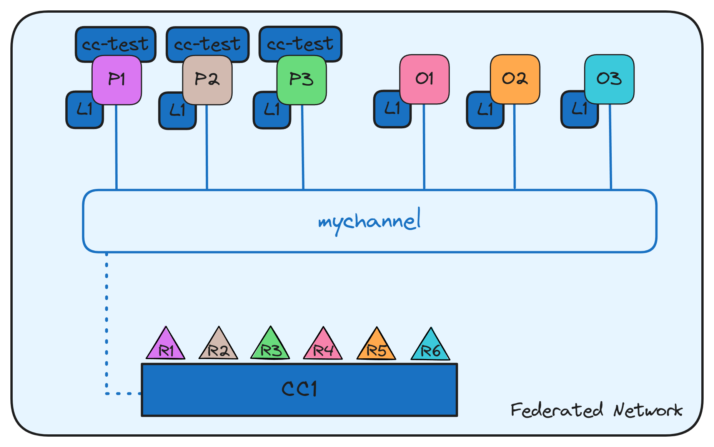

<div align="center">

# yProvTrace

### *A comprehensive permissioned blockchain network implementation with dynamic organization management and chaincode deployment.*

[![fabric-logo]](https://hyperledger-fabric.readthedocs.io/)
[![docker-logo]](https://www.docker.com/)
[![node-logo]](https://nodejs.org/)
[![shell-logo]](network/scripts/ "Bash scripts for network automation")
[![javascript-logo]](https://www.javascript.com/)
[![license-logo]](LICENSE)

</div>

---

## 📖 Introduction

**yProv** is a collaborative initiative between the [University of Trento](https://www.unitn.it) and [CMCC](https://www.cmcc.it), aimed at developing a comprehensive system for managing and exploring provenance information.

Within this ecosystem, **yProvTrace** introduces a **blockchain-based layer** that strengthens the **trustworthiness and auditability** of provenance information. Built on **Hyperledger Fabric**, it enables the secure and immutable recording of provenance data, promoting **transparency, accountability and integrity** in collaborative research environments.

This repository accompanies a **Master’s Thesis** and focuses on the design and implementation of a configurable, extensible Fabric network with dynamic organization management and chaincode lifecycle automation.

---

## 📋 Table of Contents

* [Introduction](#-introduction)
* [Project Overview](#-project-overview)
* [Getting Started](#-getting-started)
    * [Prerequisites](#prerequisites)
    * [Installation](#installation)
    * [Quick Start](#quick-start)
* [Network Module](#-network-module)
    * [Folder Structure](#folder-structure)
    * [Configuration](#configuration)
    * [Network Lifecycle](#network-lifecycle)
    * [Chaincode Lifecycle](#chaincode-lifecycle)
    * [Dynamic Organization Management](#dynamic-organization-management)
    * [Script Reference](#script-reference)
    * [Basic Setup](#basic-setup)
    * [Security Considerations](#security-considerations)
    * [Troubleshooting](#troubleshooting)
* [Chaincode Module](#-chaincode-module)
    * [Folder Structure](#folder-structure-1)
    * [Chaincode Functions](#chaincode-functions)
    * [Resource Schema](#resource-schema)
* [Acknowledgments](#-acknowledgments)
* [Additional Resources](#-additional-resources)
* [License](#-license)

---

## 📊 Project Overview

This project consists of **two main components**:

| Module             | Description                                                              | Folder       |
| ------------------ | ------------------------------------------------------------------------ | ------------ |
| [**Network**](#-network-module)    | Complete Hyperledger Fabric network with dynamic organization management | `network/`   |
| [**Chaincode**](#-chaincode-module)   | Smart contract defining resource lifecycle operations                    | `chaincode/` |

---

## 🚀 Getting Started

### Prerequisites

To run this project, ensure that all the following dependencies are installed and available: 

| Tool | Version | Purpose |
|------|---------|---------|
| 🐳 [Docker Engine](https://www.docker.com/) | v28.5 | Container runtime |
| 🟢 [Node.js](https://nodejs.org/) | v18+ | Chaincode development |

### Installation

Clone the repository and move into the project directory:

```bash
git clone https://github.com/HPCI-Lab/yProvTrace.git
cd yProvTrace
```

### Quick Start

To deploy a complete test network with minimal setup:

1. **Install the Requirements**:
   ```bash
   cd network/scripts
   ./install-requirements.sh
   ```

2. **Package the Chaincode**:
   ```bash
   ./chaincode-package.sh
   ```

3. **Run the Test Networks**:
   ```bash
   ./test-3-orgs.sh 
   ```

> [!TIP]  
> To better understand the default setup, refer to the [Basic Setup](#basic-setup) section.

---

## 🌐 Network Module

### Folder Structure

```
network/
├── 📁 compose/                     # Docker Compose definitions
├── 📁 config/                      # Network and Fabric configuration
|   ├── 📁 crypto/                  # Organization configuration files
|   ├── 📁 fabric/                  # Fabric configuration files
|   └── network.yaml                
├── 📁 configtx/                    # Channel configuration                 
├── 📁 scripts/                     # Automation scripts
└── 📁 templates/                   # Connection profiles (CCPs)
```

---

### Configuration

The network is fully parameterized through `config/network.yaml`, which defines:
- Network name and channel
- Chaincode parameters (name, version, language)
- Fabric parameters (version)
- Docker parameters (project name)
- Paths definitions

#### Example Configuration

```yaml
network:
  name: "yprovtrace-network"
  channel: "mychannel"
  chaincode:
    name: "cc-test"
    language: "javascript"
    version: "1.0"

docker:
  project: "testbed"

fabric:
  version: "2.5.14"

# Paths ...
```

---

### Network Lifecycle

> [!WARNING]  
> All operational scripts must be executed from `network/scripts`. Please refer to the [Script Reference](#script-reference) section for detailed information about each script.

```bash
cd network/scripts
```

Initially, a leader organization among the network members should be chosen, ensuring critical operations are executed only once.

Moreover, `network/identities` and `network/channel` folders must be **shared** among all the organizations, as they contain public certificates and channel artifacts needed for network operations.

#### Requirements Installation

If not already done, install Fabric binaries and dependencies:

```bash
./install-requirements.sh
```

> [!WARNING]  
> Before proceeding, please ensure that all binaries are available under the `network/bin` folder.

#### Cryptographic Material Generation

Each organization independently generates its private credentials:

```bash
./network-prepare.sh <organization-config.yaml>
```

Private keys remain local, while public certificates are saved under `network/identities` in order to be shared.

#### Genesis Block Generation (Leader Only)

```bash
./network-init.sh
```

The generated genesis block must be distributed to all participants before channel joining.

#### Containers startup and channel joining

```bash
./docker-up.sh <docker-compose.yaml>
```

If this is an orderer organization:
```bash
./network-join-orderer.sh
```

If this is a peer organization:
```bash
./network-join-peer.sh
```

Orderer and peer organizations follow distinct join procedures.

> [!NOTE]  
> Orderer and peer organizations follow distinct join procedures.

### Chaincode Lifecycle

The chaincode lifecycle follows the Fabric v2.x model:

1. Package
2. Install
3. Approve (all organizations)
4. Commit (once)

```bash
# 1️⃣ Package the chaincode 
./chaincode-package.sh

# 2️⃣ Install chaincode on the peer of each organization
./chaincode-install.sh

# 3️⃣ All orgs: approve chaincode
./chaincode-approve.sh 

# 4️⃣ Commit chaincode to channel (only once)
./chaincode-commit.sh
```

> [!IMPORTANT]  
> As **design choice**, unanimous chaincode approval is enforced to ensure strong consensus among network members.

### Dynamic Organization Management

The network supports runtime addition and removal of organizations through channel configuration updates.

Operations include:

* Join/leave request generation
* Multi-organization approval
* Configuration commitment

This approach avoids full network restarts and aligns with real-world consortium governance models.

#### Example of Runtime Joining

In the following example, the [Basic Setup](#basic-setup) with 3 organizations is extended by adding a 4th organization (`organization4`).

To add a `organization4`, it must first generate its private credentials and start its peer container:

```bash
./network-prepare.sh organization4.yaml
./docker-up.sh docker-compose-organization4.yaml
```

Then, the addition process can begin, following the steps described below:

1. Create join request
2. Approve join request (majority network members)
3. Commit join request (once)

```bash
# 1️⃣ Create join request (by an existing org, e.g. organization1)
./network-join-request.sh configtx-organization4.yaml

# 2️⃣ Approve the request (majority required)
./network-approve-update.sh org4_update_in_envelope.pb

# 3️⃣ Commit the update (only once)
./network-commit-update.sh org4_update_in_envelope.pb
```

At this point, the new organization can join the channel and set its **anchor peer**.

```bash
./network-join-peer.sh
./network-set-anchor-peer.sh
```

Finally, the chaincode must be installed and approved by the new member, followed by a re-commit by an existing organization.

> [!CAUTION]  
> After `organization4` has joined the channel, **all network members** must approve the chaincode definition again to include the new organization. Please refer to the [Chaincode Lifecycle](#chaincode-lifecycle) section for more details.

#### Example of Runtime Removal

In the following example, the network described in [Example of Runtime Joining](#example-of-runtime-joining) is reduced by removing the 4th organization (`organization4`) following the steps described below:

1. Create leave request
2. Approve leave request (majority network members)
3. Commit leave request (once)

```bash
# 1️⃣ Create leave request
./network-leave-request.sh organization4.yaml

# 2️⃣ Approve the request (majority required)
./network-approve-update.sh org4_update_in_envelope.pb

# 3️⃣ Commit the update (only once)
./network-commit-update.sh org4_update_in_envelope.pb
```

Finally, `organization4` can remove its public identity from the shared folder and optionally delete its local private credentials.

```bash
./network-leave-organization.sh --hard
./docker-down.sh docker-compose-organization4.yaml
```

---

### Script Reference

| Script | Description | Parameters | Example |
|---------|--------------|-------------|----------|
| `install-requirements.sh` | Installs Hyperledger Fabric binaries and dependencies. | *(none)* | `./install-requirements.sh` |
| `network-prepare.sh` | Generates the private credentials and create/add the public identity to the shared folder. | `<organization-config.yaml>` | `./network-prepare.sh organization.yaml` |
| `network-init.sh` | Creates the genesis block (leader org only). | *(none)* | `./network-init.sh` |
| `docker-up.sh` | Starts network containers defined in the given compose file. | `<docker-compose.yaml>` | `./docker-up.sh docker-compose-org1.yaml` |
| `docker-down.sh` | Stops and removes containers for the given organization. If the optional `--hard` flag is provided, it also prunes volumes and removes orphaned containers. | `<docker-compose.yaml>` `[--hard]` | `./docker-down.sh docker-compose-org1.yaml`<br>`./docker-down.sh docker-compose-org1.yaml --hard` |
| `network-join-orderer.sh` | Joins an orderer organization to the channel. | *(none)* | `./network-join-orderer.sh` |
| `network-join-peer.sh` | Joins a peer organization to the channel. | *(none)* | `./network-join-peer.sh` |
| `network-set-anchor-peer.sh` | Sets the anchor peer for the given organization. | *(none)* | `./network-set-anchor-peer.sh` |
| `chaincode-package.sh` | Packages the chaincode source into a deployable tarball. | *(none)* | `./chaincode-package.sh` |
| `chaincode-install.sh` | Installs the packaged chaincode on an organization’s peer(s). | *(none)* | `./chaincode-install.sh` |
| `chaincode-approve.sh` | Approves the chaincode definition for an organization. | *(none)* | `./chaincode-approve.sh` |
| `chaincode-commit.sh` | Commits the chaincode definition to the channel. | *(none)* | `./chaincode-commit.sh` |
| `chaincode-invoke.sh` | Executes a transaction (invoke) on the chaincode. **For testing only.** | *(none)* | `./chaincode-invoke.sh` |
| `chaincode-query.sh`  | Queries the chaincode state. **For testing only.** | *(none)* | `./chaincode-query.sh` |
| `network-join-request.sh` | Creates a join request proposal to add a new organization. | `<configtx.yaml>` | `./network-join-request.sh configtx-joining.yaml` |
| `network-approve-update.sh` | Approves a pending channel update. | `<proposal-file>` | `./network-approve-update.sh joining_update_in_envelope.pb` |
| `network-commit-update.sh` | Commits a channel update after approvals. | `<proposal-file>` | `./network-commit-update.sh joining_update_in_envelope.pb` |
| `network-leave-request.sh` | Creates a request to remove an organization from the channel. | `<configtx.yaml>` | `./network-leave-request.sh configtx-joining.yaml` |
| `network-leave-organization.sh` | Removes the organization public identity from the shared folder. If the optional `--hard` flag is provided, it also deletes the local private credentials. | *(none)* | `./network-leave-organization.sh` |

> [!TIP]  
> Most of the above scripts need a organization-specific configuration to be loaded before execution. This is automatically handled by implicitly sourcing `common.sh`, which interactively allow the selection of the configuration file.

---

### Basic Setup

```bash
./test-3-orgs.sh
```

In this scenario, three peer organizations (`R1, R2, R3`) and three ordering organizations (`R4, R5, R6`) have jointly decided that they will establish a network. This network has a configuration, `CC1`, which all of the organizations have agreed to and which lists the definition of the organizations as well as the policies which define the roles each organization will play on the channel (i.e. `configtx.yaml` file).

On this channel, R1, R2 and R3 will join peers, named P1, P2 and P3, to the **channel** `mychannel`, while R4, R5 and R6 owns respectively O1, O2 and O3, the ordering services of the channel. All of these nodes will contain a copy of the **ledger** (`L1`) of the channel, which is where transactions are recorded.

In this example, the chaincode `cc-test` has been installed on every peer.


---

### Security Considerations

- **Private keys** are stored locally under the `network/organizations` directory of each organization
- **Public certificates** are shared via the `network/identities` folder
- **TLS enabled** for all communications
- **Digital signatures** are used for identity verification
- **MSP-based** access control

---

### Troubleshooting

<details> <summary><b>Docker Volume Permission Issues</b></summary>

In this specific setup, the Docker Compose files assume directories like `/data_hlf1/fabric/...` to exist. 

**Solutions (choose one):**

1. **Modify the Compose files**

    Remove the user binding (1000:988) from each service and change the volume definitions to let Docker manage them:

```yaml
# In docker-compose-ord1.yaml
volumes:
    orderer_ord1_data:
        driver: local

# Do the same for the other compose files...
```

2. **Create the required directories locally**

    Manually create the directories and set ownership to match the Compose configuration:

```bash
sudo mkdir -p /data_hlf1/fabric/orderer_ord1_data
sudo mkdir -p /data_hlf1/fabric/peer0_org1_data
# create also the other required directories...

sudo chown -R 1000:988 /data_hlf1/fabric/
``` 

After applying **either solution**, you can run the basic network using:

```bash
./test-3-orgs.sh
```
</details>

<details> <summary><b>Docker Broken Pipe / Build Errors</b></summary>

The "broken pipe" occurs because the internal library Fabric uses to talk to Docker is incompatible with the way newer Docker Engines (from `v29+`) handle the socket communication during the image build process.

**Solution:** Downgrade your Docker Engine to version `28.5.0` or lower.
</details>

---

## 🧱 Chaincode Module

### Folder Structure

```
chaincode/
└── 📁 cc-test/                     # Chaincode name
    ├── 📁 lib/                     # Business logic
    │   └── resource-events.js      
    └── index.js
```

---

### Chaincode Functions

| Function | Type | Description |
|----------|------|-------------|
| `CreateResource` | Submit | Creates a new resource on the ledger |
| `UpdateResourceStatus` | Submit | Updates the status of a resource |
| `ReadResource` | Evaluate | Retrieves a resource by PID |
| `GetResourcesByTimestamp` | Evaluate | Returns resources within a timestamp range |
| `ReadAllResources` | Evaluate | Returns all resources |
| `ResourceExists` | Evaluate | Checks if a resource exists |

### Resource Schema

```javascript
{
    pid: string,           
    uri: string,           
    hash: string,          
    timestamp: string,     
    owners: string[],      
    status: integer        // 0: unknown, 1: valid, 2: revoked
}
```

---

## 🙏 Acknowledgments

This work builds upon the Hyperledger Fabric ecosystem and related open-source contributions.

<div style="display: flex; align-items: left;">
    <a href="https://github.com/hyperledger/fabric">
        
    </a>
</div>

---

## 📚 Additional Resources

- 💻 [yProvTraceInspector](https://github.com/HPCI-Lab/yProvTraceInspector)
- 📖 [Hyperledger Fabric Documentation](https://hyperledger-fabric.readthedocs.io/)

---

## 📄 License

[![license-logo]](LICENSE)

<div align="right">

[](#top)

</div>

<!-- LOGOs -->
[fabric-logo]: https://img.shields.io/badge/Hyperledger%20Fabric-2.5.14-orange?style=for-the-badge
[shell-logo]: https://img.shields.io/badge/Shell-Bash-4EAA25?style=for-the-badge&logo=gnu-bash
[docker-logo]: https://img.shields.io/badge/Docker-v28.5-2496ED?style=for-the-badge&logo=docker
[node-logo]: https://img.shields.io/badge/Node.js-v18+-339933?style=for-the-badge&logo=node.js&logoColor=white
[javascript-logo]: https://img.shields.io/badge/JavaScript-ES6+-F7DF1E?style=for-the-badge&logo=javascript&logoColor=black
[license-logo]: https://img.shields.io/badge/License-GPL%20v3-yellow?style=for-the-badge

